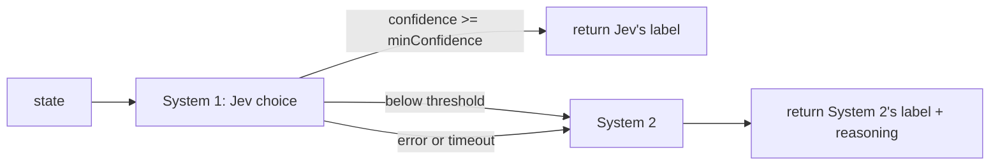

# typesafe-cascade

[](https://github.com/monumei/typesafe-cascade/actions/workflows/ci.yml)

It's easy to send every classification straight to a big reasoning model, even when the answer is obvious. I wanted to try the other way around: ask [TypeSafe](https://typesafe.ai)'s Jev first, since it gives back a label plus a probability for every label, and only call the expensive model when Jev isn't sure.

So that's what this is. Jev answers a typed `choice` question. If its confidence clears your threshold, you take its answer. If it doesn't, or Jev errors or misses the deadline, the request goes to your System 2 (an LLM, a rules engine, or a human queue) together with Jev's attempt.



## Usage

```ts
import { CascadeClassifier } from "./src";

type Queue =
  "refund_request" | "account_security" | "bug_report" | "general_inquiry";

const triage = new CascadeClassifier<Queue>({
  instructions: "Route this support ticket to the right queue.",
  criteria: {
    refund_request: "Wants money back or a charge reversed",
    account_security: "Unauthorized access or compromised credentials",
    bug_report: "Crashes, errors, or broken features",
    general_inquiry: "Questions, feedback, anything else",
  },
  minConfidence: 0.85,
  timeoutMs: 2500,
  // system1 defaults to Jev and reads TYPESAFE_API_KEY
  system2: async (state, { reason, system1Attempt, criteria }) => {
    // call your reasoning model here; system1Attempt is set when reason === "low-confidence"
    return { choice: "bug_report", reasoning: "..." };
  },
});

const result = await triage.classify({
  message: "The app crashed at checkout. Was I charged?",
});
// result.choice            -> one of Queue
// result.resolvedBy        -> "system-1" | "system-2"
// result.escalationReason  -> "low-confidence" | "system1-error" | "timeout" | undefined
// result.system1Details    -> Jev's label and per-label probabilities, when Jev answered
```

The label type comes from the keys of `criteria`, so a typo in a label fails at compile time. I also check both sides at runtime, because a model can still hand back something you didn't ask for. If Jev returns a label outside `criteria` or a confidence outside 0..1, I treat it as a System 1 error and escalate. If System 2 returns a bad label, `classify` throws, since nothing sits behind System 2 to catch it.

## A few things worth knowing

- Jev gets one shot per request. `createTypeSafeSystem1` turns off SDK retries, since escalating to System 2 already covers that failure.
- On timeout I abort System 1's `AbortSignal`, so the in-flight Jev request actually gets cancelled instead of left running.
- If System 2 throws, `classify` rejects with that error. It won't loop back and call System 2 again.
- `confidence` on the result is always Jev's number, and it's `0` when Jev never answered. System 2 doesn't report one.
- `createTypeSafeSystem1(apiKey?, model?)` falls back to the SDK defaults (`TYPESAFE_DEFAULT_MODEL`, `TYPESAFE_BASE_URL`, then `jev-latest`). I'd pin a model in production so a model update can't quietly move your threshold.

## Does it actually work on real data?

That's the part I wanted to measure instead of guess, so I'm not putting savings numbers here until the eval says something.

The test case is GitHub issue triage: given an issue's title and body, is it a `bug`, `feature`, `docs`, or `question`? Maintainers of big repos already label these by hand, which gives me free ground truth. `eval/manifest.jsonl` pins 2,319 closed and open issues from React, TypeScript, VS Code, Svelte, Rust, Bun, and Deno, each with exactly one human-applied type label (688 bug, 788 feature, 422 docs, 421 question). Issues with no type label, or with conflicting ones, are left out since there's no single right answer to score against.

The manifest only holds the repo, issue number, and the label at snapshot time, so the ground truth stays put even if maintainers relabel later. The issue text isn't in git. `eval:run` pulls titles and bodies from GitHub through `gh` the first time it needs them (about a minute), into the gitignored `eval/data/`.

```bash
TYPESAFE_API_KEY=... bun run eval:run 20   # smoke test on 20 issues
TYPESAFE_API_KEY=... bun run eval:run      # the rest; answers are cached, so reruns don't pay twice
bun run eval:report            # writes eval/results/<model>.md

bun run eval:fetch             # re-download issue text for the pinned manifest
bun run eval:sample            # resample a new manifest (100 issues per label per repo)
```

Answers and reports are kept per model, so you can set `TYPESAFE_DEFAULT_MODEL=jev-1.14.0` (or whatever's next), rerun, and diff two Jev versions on the same 2,319 issues. I'd pin a version rather than use `jev-latest` here, since `latest` moves.

The report has three tables:

- **Threshold sweep:** for each `minConfidence`, how many issues Jev keeps, how many escalate, and how accurate Jev is on the ones it keeps.
- **Per label:** the same thing split by label, because a good average can hide a weak class.
- **Calibration:** whether issues Jev marks around 0.9 are actually right around 90% of the time. This is what makes the cascade worth it in the first place.

A couple of caveats, so the numbers don't get over-read:

- The sample is balanced across labels on purpose. A real repo is mostly bugs (about 88% of recent labeled Bun and Deno issues), so the report also prints what "always answer bug" would score.
- These repos use issue templates, so Jev sees the same structure a real triage bot would. That probably makes bug vs. feature easier than free-form text.

## Run it

Needs [Bun](https://bun.sh) 1.4.

```bash
bun install
bun test            # cascade behavior plus the eval metrics
bun run typecheck   # bun check
bun start           # support-ticket demo
```

Without `TYPESAFE_API_KEY`, the demo uses a keyword stand-in for Jev and a stub System 2, and the latencies it prints are just `Bun.sleep`. Set the key to send the System 1 calls to Jev:

```bash
TYPESAFE_API_KEY=... bun start
```

## Layout

- `src/cascade.ts` has `CascadeClassifier` and the Jev provider, `createTypeSafeSystem1`.
- `src/types.ts` has the provider and result types.
- `src/demo.ts` runs support-ticket triage on four tickets, three clear and one ambiguous.
- `eval/` fetches labeled issues, runs Jev over them, and builds the report.
- `test/` covers the escalation paths with mock providers, plus the eval metrics.

## License

MIT
