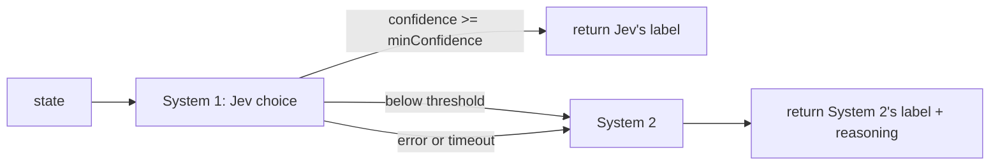

# typesafe-cascade

[](https://github.com/monumei/typesafe-cascade/actions/workflows/ci.yml)

A small TypeScript module that puts [TypeSafe](https://typesafe.ai)'s Jev in front of a reasoning model. Jev answers a typed `choice` question with a label, a confidence, and a probability for every label. If the confidence clears your threshold, you take Jev's answer. If it doesn't, or Jev errors or misses its deadline, the cascade hands the request to your System 2 (an LLM, a rules engine, a human queue) along with Jev's attempt.



## Usage

```ts
import { CascadeClassifier } from "./src";

type Queue = "refund_request" | "account_security" | "bug_report" | "general_inquiry";

const triage = new CascadeClassifier<Queue>({
  instructions: "Route this support ticket to the right queue.",
  criteria: {
    refund_request: "Wants money back or a charge reversed",
    account_security: "Unauthorized access or compromised credentials",
    bug_report: "Crashes, errors, or broken features",
    general_inquiry: "Questions, feedback, anything else",
  },
  minConfidence: 0.85,
  timeoutMs: 2500,
  // system1 defaults to Jev and reads TYPESAFE_API_KEY
  system2: async (state, { reason, system1Attempt, criteria }) => {
    // call your reasoning model here; system1Attempt is set when reason === "low-confidence"
    return { choice: "bug_report", reasoning: "..." };
  },
});

const result = await triage.classify({ message: "The app crashed at checkout. Was I charged?" });
// result.choice            -> one of Queue
// result.resolvedBy        -> "system-1" | "system-2"
// result.escalationReason  -> "low-confidence" | "system1-error" | "timeout" | undefined
// result.system1Details    -> Jev's label and per-label probabilities, when Jev answered
```

`TChoice` comes from the keys of `criteria`, so a typo in a label fails at compile time. Both providers also get checked at runtime: a System 1 label outside `criteria`, or a confidence outside 0..1, counts as a System 1 error and escalates. A System 2 label outside `criteria` throws, since nothing sits behind System 2 to catch it.

## Behavior worth knowing

- System 1 gets one shot per request. `createTypeSafeSystem1` turns off SDK retries because escalation to System 2 already covers that failure.
- On timeout the cascade aborts System 1's `AbortSignal`, so the in-flight Jev request gets cancelled instead of left running.
- If System 2 throws, `classify` rejects with that error. The cascade won't loop back and call System 2 a second time.
- `confidence` on the result always reports System 1's number, and it reads `0` when System 1 never answered. System 2 doesn't report a confidence.
- `createTypeSafeSystem1(apiKey?, model?)` uses the SDK's defaults for model and base URL (`TYPESAFE_DEFAULT_MODEL`, `TYPESAFE_BASE_URL`, then `jev-latest`). Pin a model in production so a model update can't move your threshold under you.

## Picking `minConfidence`

The right threshold depends on your labels and your data, so this repo ships no default savings or accuracy figures. To choose one, run Jev over a labeled sample, keep `system1Details.probabilities` and the true label, and plot System 1 accuracy and escalation rate against the threshold. Pick the point where System 1's error rate on the requests it keeps matches what your queue can tolerate.

## Run it

Requires [Bun](https://bun.sh) 1.4.

```bash
bun install
bun test            # 8 tests: thresholds, timeout, provider errors, label validation
bun run typecheck   # bun check
bun start           # ticket triage demo
```

Without `TYPESAFE_API_KEY`, the demo uses a keyword stand-in for Jev and a stub System 2, and the latencies it prints come from `Bun.sleep`. Set the key to send the System 1 calls to Jev:

```bash
TYPESAFE_API_KEY=... bun start
```

## Layout

- `src/cascade.ts` holds `CascadeClassifier` and the Jev provider `createTypeSafeSystem1`.
- `src/types.ts` defines the provider and result types.
- `src/demo.ts` runs support-ticket triage with four tickets: three clear, one ambiguous.
- `test/cascade.test.ts` covers the escalation paths with mock providers.

## License

MIT
